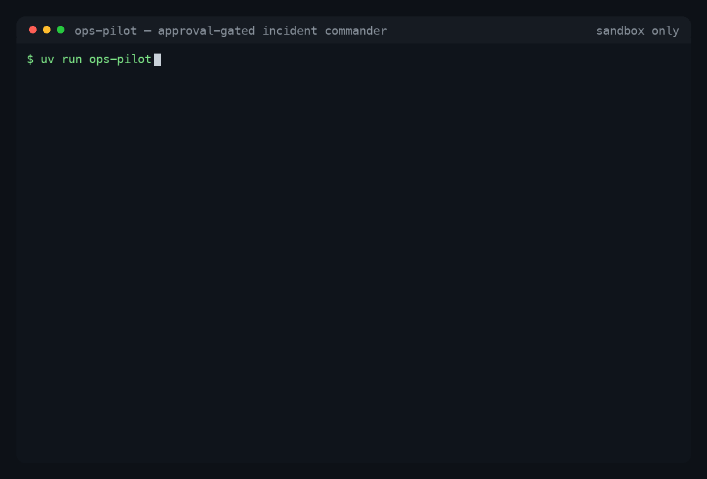

# OpsPilot

[](https://github.com/padrisimo/ops-pilot/actions/workflows/ci.yml)
[](LICENSE)
[](https://www.python.org/)
[](https://langchain-ai.github.io/langgraph/)

**An approval-gated SRE incident commander built with LangGraph.**

OpsPilot investigates a production incident, shows the evidence that supports (or
undermines) a diagnosis, proposes a remediation, and **stops** for human approval
before writing anything. Every action is recorded in an append-only ledger and can
be rolled back.

The model explains and orchestrates. It does not invent metrics, logs, deploys or
arithmetic: those come from a deterministic analysis layer over mock telemetry.

```text
alert / incident
      │
      ▼
get_incident ──► analyze_incident (deterministic: metrics, logs, changes, runbook)
      │                    │
      │                    ▼
      │           ranked hypotheses + confidence
      ▼                    │
   LLM explains ◄──────────┘
      │
      ▼
propose_remediation ──► pending draft
      │
      ▼
apply_remediation ──► interrupt() ──► human approve / reject
      │                                   │
      ▼                                   ▼
sandbox ledger                      nothing written
      │
      ▼
rollback_remediation ──► interrupt() ──► reversal + audit entry
```

## Demo



The walkthrough covers the full loop: evidence, a pending draft, human approval, the
append-only ledger and the audit event. The last screen shows `INC-1005`, where the
agent refuses to invent a cause and asks for more context instead.

The clip is rendered from the deterministic analysis and sandbox outputs
(`scripts/render_cli_demo.py`), so it stays reproducible without an API key.

## Why this project

Most "LLM agent" demos let the model take irreversible actions. OpsPilot is built
around the opposite idea:

- **Evidence before narrative.** `analysis.py` computes baselines, peaks, ratios,
  log signatures, related changes and hypothesis scores in plain Python.
- **Confidence gates action.** A low-confidence or unknown diagnosis does not
  produce a remediation. The agent asks a focused question instead.
- **Approval is a graph primitive.** `apply_remediation` and `rollback_remediation`
  call LangGraph's `interrupt()` and resume with `Command(resume="approve" | "reject")`.
  The pause survives process restarts because state is checkpointed in SQLite.
- **The sandbox is append-only.** Rejections write nothing to the ledger; rollbacks
  append a reversal and mark the original action; repeated calls are explicit no-ops.
- **`data/` is read-only.** All runtime writes go to `sandbox/`.

## Demo incidents

| Incident | Service | What the evidence shows | Proposed action |
| --- | --- | --- | --- |
| `INC-1001` | `checkout-api` | A deploy lowered a client timeout; p95 and 5xx spike afterwards | `rollback_deploy` |
| `INC-1002` | `payments-db` | Connection pool saturation with pool-timeout logs | `raise_db_pool` |
| `INC-1003` | `pricing-api` | Feature flag enabled before a 5xx spike | `disable_feature_flag` |
| `INC-1004` | `search-api` | Disk above 90% after a failed log-rotation job | `rotate_logs` |
| `INC-1005` | `auth-api` | Healthy metrics, no change, one vague complaint | **unknown → ask the human** |

`INC-1005` is intentional: the interesting safety case is the incident that should
*not* be "fixed".

For a chronological record of the design and the bugs found while testing, see
[`docs/BUILD_LOG.md`](docs/BUILD_LOG.md).

## Quick start

Requires Python 3.12+ and [uv](https://docs.astral.sh/uv/).

```bash
uv sync
cp .env.example .env    # add OPENROUTER_API_KEY (free key)
```

### LangGraph Studio (optional)

The repository includes a `langgraph.json`, so you can inspect and replay runs in
LangGraph Studio / LangSmith:

```bash
uv run langgraph dev
```

Open the URL it prints (or let it open the browser). The graph is exposed as
`ops_pilot`; the API server owns persistence, so this entrypoint compiles without
the local SQLite saver. If `LANGSMITH_TRACING=true` and `LANGSMITH_API_KEY` are set,
each run is also traced in LangSmith.

### Streamlit UI

```bash
uv run streamlit run app.py
```

Use the incident buttons in the sidebar, expand the evidence panels, then approve or
reject the pending remediation. The audit log is in the sidebar.

### Terminal REPL

```bash
uv run ops-pilot
```

Commands: `/incidents`, `/audit`, `/new`, `/quit`. When the graph pauses, the CLI
prints the approval payload and asks `Approve? [y/N]`.

### Persistence

LangGraph state — conversations, tool messages and pending approvals — is stored in
`sandbox/checkpoints.sqlite` by default. Restarting the CLI or the Streamlit app
resumes the same thread, including an approval that was waiting for a human.

```bash
# default; relative paths are resolved from the working directory
OPS_PILOT_CHECKPOINT_DB=sandbox/checkpoints.sqlite

# opt out of persistence (for ephemeral runs and tests)
OPS_PILOT_CHECKPOINT_DB=memory
```

The test suite uses `MemorySaver` explicitly, so it never touches the real
checkpoint database.

## Models

The default is OpenRouter's **free auto-router**, so a free OpenRouter key is enough:

```bash
MODEL=openrouter:free
# equivalent: MODEL=openrouter:openrouter/free
OPENROUTER_API_KEY=...
```

To pin a specific free model:

```bash
MODEL=openrouter:<vendor>/<model>:free
```

OpenAI is still supported:

```bash
MODEL=openai:gpt-4o-mini
OPENAI_API_KEY=...
```

Free OpenRouter models are rate-limited and may vary in tool-calling quality. OpsPilot
requires tool calling, so the free auto-router is the safest default. The LLM is only
used in the `agent` node: tools, analysis and the sandbox work without any provider
key, which is what the test suite exercises.

## Architecture

```text
src/ops_pilot/
├── data.py       typed, read-only loaders for data/*.json
├── analysis.py   deterministic baselines, anomalies, log signatures, hypotheses
├── sandbox.py    drafts, append-only ledger, rollback, audit log
├── context.py    AppContext (data + sandbox) dependency container
├── tools.py      12 LangChain tools, including approval-gated writes
├── model.py      OpenRouter free / OpenAI model construction
├── graph.py      StateGraph(MessagesState) + ToolNode + checkpointer
├── cli.py        terminal REPL
└── ui.py         Streamlit chat UI

langgraph.json       LangGraph CLI / Studio configuration
langgraph_app.py     API entrypoint without a local checkpointer
scripts/render_cli_demo.py  README CLI demo generator
```

The graph is hand-built rather than prebuilt:

```python
builder = StateGraph(MessagesState)
builder.add_node("agent", agent_node)
builder.add_node("tools", ToolNode(tools))
builder.add_edge(START, "agent")
builder.add_conditional_edges("agent", tools_condition)
builder.add_edge("tools", "agent")
graph = builder.compile(checkpointer=checkpointer)
```

### Hypothesis scoring

Each signal contributes to a transparent score:

| Signal | Score |
| --- | --- |
| Deploy within 60 min + latency/error anomaly | 0.95 |
| Deploy outside the hour + anomaly | 0.72 |
| Pool logs **and** pool metric anomaly | 0.95 |
| Only one of pool logs / pool metrics | 0.70 |
| Flag change **and** flag-related errors | 0.95 |
| Only one of flag change / flag errors | 0.70 |
| Disk usage ≥ 85% with rotation evidence | 0.95 |
| Traffic ≥ 2× baseline | 0.75 |
| Nothing anomalous | 0.10 (`unknown`) |

`high` confidence starts at 0.80, so only well-supported causes produce a
`recommended_action`. The calculation string is returned with the hypothesis and is
shown to the user.

## Tools

| Tool | Purpose |
| --- | --- |
| `list_incidents`, `get_incident` | incident, service and runbook context |
| `query_metrics`, `search_logs`, `recent_changes` | raw, time-windowed evidence |
| `get_runbook` | the service's documented procedure |
| `analyze_incident` | deterministic metrics + logs + changes + hypotheses |
| `propose_remediation` | create a pending draft (no production change) |
| `apply_remediation` | **interrupts for approval**, then writes to the sandbox ledger |
| `rollback_remediation` | **interrupts for approval**, then appends a reversal |
| `get_audit_log`, `get_pending_drafts` | inspect what happened and what awaits approval |

## Sandbox files

Created at runtime and ignored by git:

| File | Contents |
| --- | --- |
| `sandbox/drafts.json` | proposed remediations and their status |
| `sandbox/ledger.json` | append-only applied actions and reversals |
| `sandbox/audit_log.json` | `propose`, `apply`, `reject`, `rollback`, `*_noop` events |
| `sandbox/checkpoints.sqlite` | LangGraph threads, messages, tool state and pending interrupts |

Statuses: `pending → applied → rolled_back`, or `pending → rejected`.

## Tests

```bash
uv run pytest
```

The suite covers data loading, analysis for all five incidents, sandbox validation
and idempotency, SQLite checkpoint persistence, model configuration, and the real
approval flow: a minimal `StateGraph` with `ToolNode` invokes the tools, pauses on
`interrupt()`, and resumes with `Command(...)` — no LLM or API key required.

CI runs the same suite plus `langgraph validate` on every push and pull request.

## Design notes

- **Deterministic core, LLM shell.** The model cannot fabricate a baseline because
  the analysis payload is computed before it speaks.
- **Approval is not a prompt instruction.** It is an `interrupt()` in the tool, so a
  model that "forgets" the instruction still cannot apply a draft without a resume
  value.
- **Pure validation runs before the interrupt.** LangGraph re-executes the node from
  the start on resume, so side effects must stay after the pause. This is also why
  the sandbox tracks idempotency.
- **Mock data, real state machine.** Swapping `data/` for Prometheus, Loki and a
  change feed would not change the graph, the tools or the approval contract.

## Limitations

- Telemetry is mocked and static; there is no live monitoring integration.
- The sandbox "applies" actions by writing JSON records, not by calling real APIs.
- Checkpointing is local SQLite; there is no shared checkpoint backend.
- Hypothesis rules are deliberately simple and explainable, not a general RCA engine.
